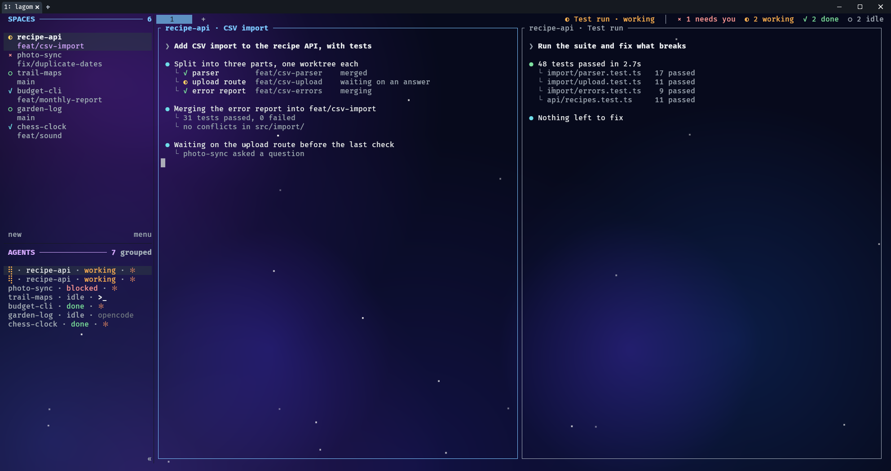
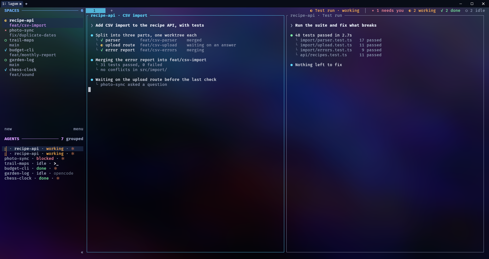
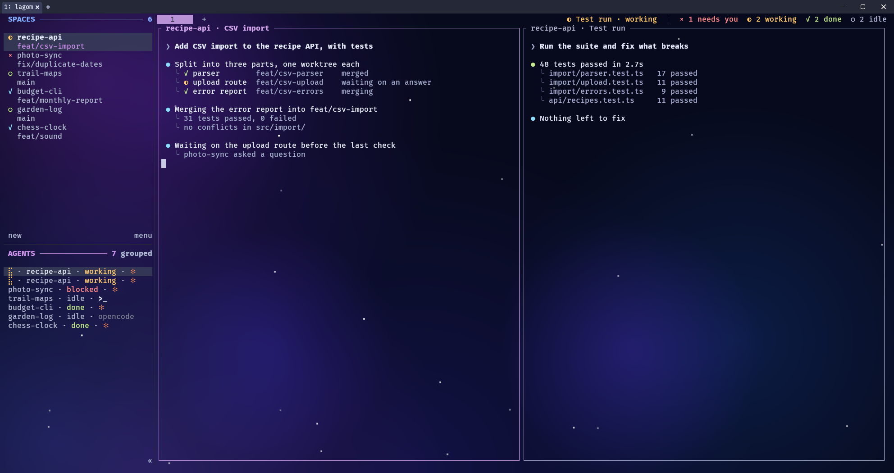
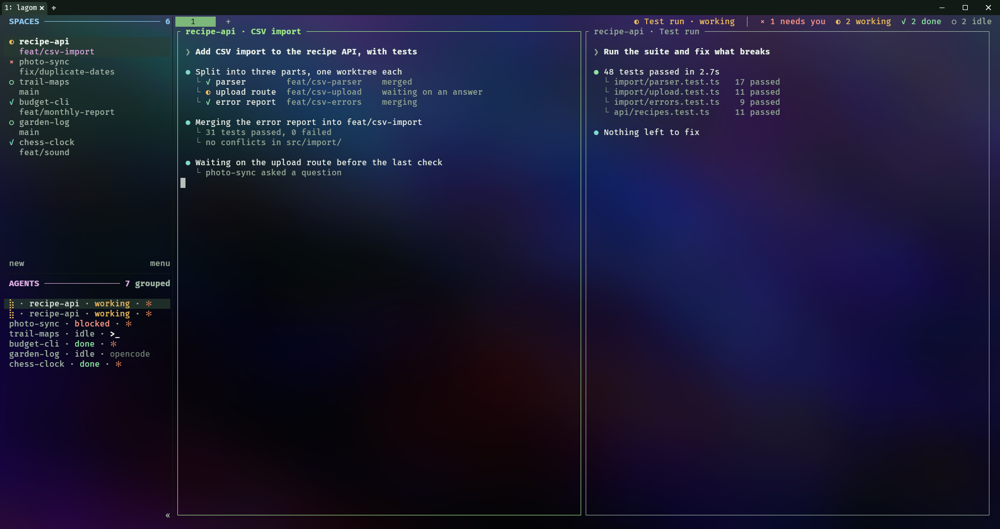
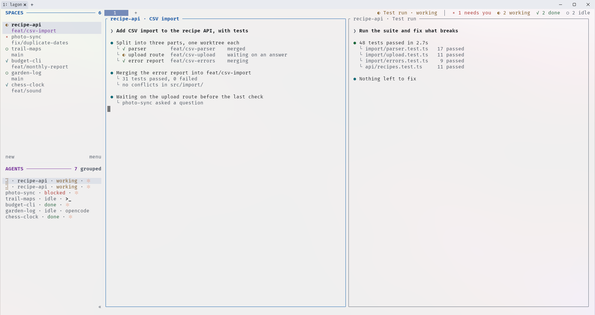
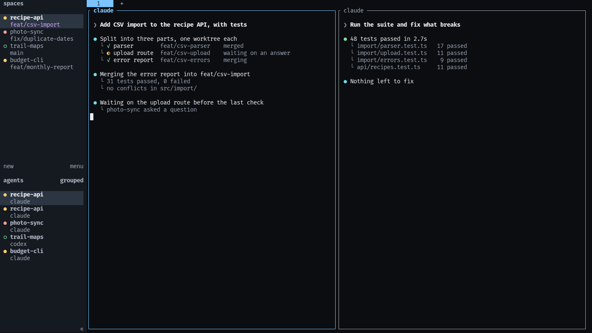

# Lagom TUI

One look for the Herdr TUI, the terminal it runs in and the Claude Code status line. Six themes, four wallpapers, and a
dimming that is measured from the picture so text stays at WCAG 2.2 AA (4.5:1).



The whole look in WezTerm: graphite theme, starfield wallpaper, panes you can see through. `lagom install` gives you
the colours, the wallpaper and the status in the tab bar. Three things in the picture are extra, all described in
[`patches/README.md`](patches/README.md): the spinner and agent logos come from the
[`hasuwini77.spinner`](https://github.com/hasuwini77/herdr-spinner) plugin and one sidebar row in your config; the
` SPACES ───── 6` / ` AGENTS ───── 7` headings and the colours in the tab-bar status need a patched Herdr build.

Other looks, same session and same extras. Each is two commands: `lagom theme <name>`, `lagom wallpaper <name>`.

| | |
|---|---|
|  neon + nebula |  palenight + starfield |
|  moss + nebula |  paper + dawn |



Stock Herdr 0.9.5 with nothing but the theme, in a plain terminal without a wallpaper.

All pictures are taken from a throwaway session: the workspaces are invented and the panes are stand-ins
(`docs/demo-setup.sh`).

## Install

```sh
herdr plugin install hasuwini77/herdr-lagom-tui
herdr plugin action invoke hasuwini77.lagom.setup     # hooks in, links ~/.local/bin/lagom, backs up every file it edits
```

Or without the plugin system: `git clone https://github.com/hasuwini77/herdr-lagom-tui && herdr-lagom-tui/bin/lagom install`.

On native Windows (no WSL) the plugin system needs `python3` on PATH, so use the clone:

```powershell
git clone https://github.com/hasuwini77/herdr-lagom-tui
py herdr-lagom-tui\bin\lagom install
py -m pip install windows-curses   # only for the menu and the file tree
```

Needs Python 3 and Herdr 0.9.5 or later. To undo everything: `lagom uninstall`.

| Platform | Status |
| --- | --- |
| macOS (WezTerm) | tested on Apple silicon, macOS 26 |
| Linux, WSL2 (WezTerm, Windows Terminal) | tested under WSL2 |
| Windows, native (WezTerm, Windows Terminal) | covered by `tests/smoke.py`; `lagom` is a `.cmd` shim in `~/.local/bin` |

`python tests/smoke.py` installs, switches theme and wallpaper, and uninstalls in a throwaway home with a fake
Herdr, then checks that every file is back as it was.

It drives five things from one command:

| What | How |
| --- | --- |
| Herdr TUI | a managed `[theme]` block in `~/.config/herdr/config.toml` (or `$HERDR_CONFIG_PATH`), then `herdr server reload-config`; your own `[theme]` tables are commented out with `#lagom-off#` and come back on uninstall |
| WezTerm | `lagom.lua` reads `lagom-state.json`; WezTerm reloads when that file changes |
| Windows Terminal | a `Lagom` colour scheme, tab strip theme and background image in `settings.json` (from WSL or native Windows) |
| ccstatusline | the colours of `~/.config/ccstatusline/settings.json`; your layout is kept as the template |
| Claude Code | `lagom hook` (pane titles) on four hook events in `~/.claude/settings.json`; your other hooks stay |

## Use

```sh
lagom theme                  # list: graphite, moss, neon, palenight, paper, contrast
lagom theme palenight        # or: lagom theme next
lagom wallpaper nebula       # aurora, dawn, nebula, starfield · none · keep (your terminal's own picture)
lagom menu                   # all of the above from a list
lagom custom '#ff9e64'       # your own accent on the current theme; refused below 4.5:1
lagom panes glass            # picture through the panes, AA-safe · solid: sidebar only · 0.5: lighter still
lagom statusline one-line    # one row: model, context, week, reset, branch · mine: your own layout back
lagom uninstall              # removes every hook, restores Windows Terminal's old values
```

Inside Herdr, after install:

- the tab bar's right end shows the pilot: the working agent that changed last, and how many wait for you
- `prefix+shift+b` focuses the agent that has waited longest
- `prefix+comma` opens the Lagom menu in a popup
- `prefix+shift+e` shows or hides the file tree on the right edge of the tab
- a Claude Code pane's border reads `folder · topic` instead of `claude`

## The file tree

The file tree works like an editor's sidebar: folders open in place, with a coloured icon per file type.

| Key or click | Does |
| --- | --- |
| click, `enter` | open or close a folder; on a file, send `@path` to the pane you came from |
| `↑ ↓`, wheel | move |
| `→` `←` | open a folder · close it, or jump to its parent |
| `p` | view the file |
| `.` | show hidden files |
| `-` | go up one folder |
| `i` | plain icons, for a font without Nerd Font glyphs |
| `q` | close the panel |

## How the dimming works

`lib/measure.py` reads the brightest 1% of the picture (darkest 1% for a light theme). `lagom`
then raises the share of the theme's background colour laid over the picture, one percent at a
time, until the weakest of the 22 text colours reaches 4.5:1 against that worst spot. WezTerm
gets it as a colour layer, Windows Terminal as `backgroundImageOpacity`.

## Files

- `bin/lagom` — the command (Python 3, standard library only)
- `themes/lagom-*.json` — the palettes, shared with the Herdr App layout of the same name
- `wallpapers/*.png` — generated pictures (1920×1080; starfield is 2880×1620)
- `wezterm/lagom.lua` — the WezTerm side
- `statusline/one-line.json` — the one-row ccstatusline layout
- `lib/measure.py` — picture measuring (Pillow, ImageMagick or a plain PNG reader)
- `herdr-plugin.toml` — the plugin: a set-up action, next theme, next wallpaper, next blocked agent, the menu as a popup
- `patches/` — two optional Herdr source patches (section headings, coloured tab-bar status); not needed for the themes
- `docs/demo-*.sh` — builds the invented session the pictures above were taken from (`LAGOM_DEMO_FULL=1` for the whole look)

## Limits

- WezTerm is themed on macOS, Linux, WSL and Windows; Windows Terminal from WSL or native Windows. On macOS a
  Lagom wallpaper turns WezTerm's window blur off: the window is opaque, so the blur only costs GPU time.
- The WezTerm hook needs `return config` at the end of `.wezterm.lua` (or `.config/wezterm/wezterm.lua`).
- File icons need a Nerd Font in Windows Terminal (restart it after installing one); WezTerm ships the symbols itself.
- Icons are font glyphs, one colour each: a terminal cannot draw VS Code's picture icons.
- ccstatusline colours are mapped from the colours found at install; other colours stay as they are.
- `lagom panes` with a number under the glass value trades accent-pill contrast for a lighter pane (0.5 on graphite + starfield: 3.2:1, body text 6.7:1).
- Three wallpapers are 1920 px wide and look soft on a wider window (starfield is 2880).
- The status line needs `ccstatusline` installed and set as Claude Code's `statusLine` command.
- The tab-bar line is plain text: Herdr strips colour from command output.
- In WezTerm the picture shows inside Herdr's panes: filled cells are drawn 50–100% opaque, the lowest value that keeps pill text at 4.5:1 (set `cell_opacity` in `~/.config/lagom/state.json` to override).
- The tab bar's status line is plain text: the pilot plus counts (needs you · working · done · idle). Herdr 0.9.5 has no clickable tab-bar buttons.
